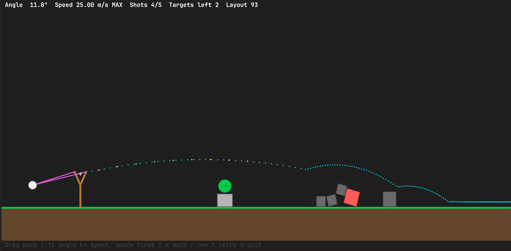

# Slingshot

A small Angry Birds-like game that runs in the terminal, made for learning the
real physics of throwing. In some terminals the play area is drawn with smooth,
solid shapes; elsewhere it is drawn with braille characters. See
[docs/PHYSICS.md](docs/PHYSICS.md) for the physics.



It is written in Rust, using rapier2d for the simulation, ratatui and crossterm
for the terminal, and png and base64 for the images.

## Setup

You need:

- Rust (tested with 1.89). The crate uses the 2024 edition. Cargo downloads the
  libraries on the first build.
- An interactive terminal of at least **80×24** with mouse support. The braille
  drawing also needs a font with braille characters. About 30 rows or more is
  nicer with the math panel open.

There is nothing else to install or configure.

## Run

The game is in `projects/angry-bird`. Run all the commands in this file from
that folder. From the root of the repository:

```sh
cd projects/angry-bird
cargo run --release
```

## Test

```sh
cargo test
```

The tests need no real terminal.

| File | What it checks |
|---|---|
| `tests/physics.rs` | The formulas and turning a pull into a throw |
| `tests/world.rs` | The simulation against the formulas, the fixed level, winning and losing, the fixed time step |
| `tests/layouts.rs` | Every layout fits and stands still, picking layouts, room for the longest pull |
| `tests/ui.rs` | Mouse and keyboard, and the text screen at the smallest size |
| `tests/graphics.rs` | Choosing image or braille drawing, the images and escape sequences, smooth motion |

`tests/layouts.rs` also has a slow test that is skipped unless you ask for it. It
checks that every layout can be won (see [Adding objects](#adding-objects)).

The tests do not show how the game looks in a real terminal, so check drawing
changes by playing.

## Picture quality

In iTerm2, WezTerm, kitty and Ghostty the play area is drawn as a high
resolution image with solid, smooth-edged shapes. Other terminals (including
macOS Terminal), and any terminal inside tmux or screen, cannot get this: they
use braille characters, which look dotted and blocky, and the game says so at
the top of the play area. The game plays the same either way.

The game recognises terminals from environment variables such as `TERM_PROGRAM`
and `TERM`. The status line, math panel and key help are always ordinary text.

The screen is updated up to 30 times a second with images and 60 with braille.
An image is only sent again when it changes. Set `SLINGSHOT_FPS` to a whole
number to change the rate; it is limited to 10–60. For example, try
`SLINGSHOT_FPS=60` with images. Whether it looks smoother depends on how fast the
terminal can show images.
Moving things are drawn between the last two physics steps, so each frame moves
them by an even amount.

To override the choice, set `SLINGSHOT_GRAPHICS` to `iterm`, `kitty` or
`braille`. Use `braille` if the play area stays empty, flickers or lags (for
example over a slow ssh connection). `iterm` or `kitty` can be forced for
another terminal that supports that image protocol.
Upper or lower case both work, and other values are ignored. An override also
applies inside tmux or screen, but it does not make an unsupported terminal, or
tmux, able to show images.

```sh
SLINGSHOT_GRAPHICS=braille cargo run --release
```

## Play

Knock down all 7 targets with 5 balls. A target counts once it has been moved
0.8 m from where it started, or (for a crate) tipped more than 35°. Knocked
down targets turn dark grey. The grey pedestal is not a target.

Each game has one of 1000 layouts: the order of the two big crates, the melon
and the pizza tower changes, as do the spaces between them and the height of the
melon's pedestal. You get a new one each time you start the game or press `r`.
Press `t` to try the same layout again. The status line shows its number; to
start with a particular one, run `SLINGSHOT_LAYOUT=123 cargo run --release`.

| Action | Mouse | Keyboard |
|---|---|---|
| Aim | Press near the `+` and drag back | ↑ ↓ angle (1°), ← → speed (0.25 m/s) |
| Throw | Release | Space |
| Cancel a drag | Right-click (or release without a real pull) | `m`, `r` or `t` also cancel it |
| Math panel on/off | | `m` |
| New game, new layout | | `r` |
| Retry the same layout | | `t` |
| Quit | | `q`, Esc or Ctrl-C |

Pull distance sets the speed (a 5 m pull gives the top speed of 25 m/s) and pull direction sets the
angle (0° to 90°). The drag may continue outside the play area. Your aim is kept
after a throw, a retry and a new game, so you can adjust it a little at a time. You
can throw again once everything has almost stopped moving, when the ball has
flown far out of the level, or after 10 seconds at the latest.
A pull that would give less than 2 m/s, or that goes up and forward, does not
throw.

## Project layout

`Cargo.toml` and `Cargo.lock` are in `projects/angry-bird`, `docs/` holds the
physics explanation and the screenshot, and the tests are in `tests/` (see
[Test](#test)). The game is one Rust crate, `slingshot`:

| File | What is in it |
|---|---|
| `src/physics.rs` | The launch and flight math, as pure functions |
| `src/level.rs` | The level, as data |
| `src/world.rs` | rapier2d simulation, fixed time step, shots, win and loss |
| `src/input.rs` | Keyboard and mouse |
| `src/render.rs` | What is drawn, braille drawing, the math panel, metres ↔ terminal cells |
| `src/graphics.rs` | High resolution drawing with terminal image protocols |
| `src/main.rs` | Terminal setup and restore, game loop |
| `src/lib.rs` | Makes the modules available to the game and the tests |

The world is in metres. It is converted to terminal cells (or image pixels) only
for drawing, and back again for the mouse, using `Viewport`. Angles look right when a terminal cell
is about twice as tall as it is wide, which is usual. The numbers are correct
with any font. The physics always advances in steps of 1/120 s, whatever the
frame rate.

## Adding objects

The game plays the layouts made by `layout` in `src/level.rs`. It places groups
(a crate, the melon on its pedestal, the pizza tower) between `ZONE_LEFT` and
`ZONE_RIGHT`, at least `MIN_GAP` apart. To add something, add a `Group`, give it
a width, and place its objects in `layout`. Positions are object **centres** in
metres, with the ground at `y = 0`; objects resting on each other should exactly
touch. All groups and gaps must fit in the zone. Use `Role::Target` for things
to knock down and `Role::Fixed` for things that never move. The screen shows at
least `x` from 0 to 42 m (`VIEW_RIGHT` in `src/render.rs`).

`LEVEL` in the same file is one fixed arrangement that the tests use. It also
sets the launch point, the number of balls and the ball size for all layouts.

Then run `cargo test`, which checks that every layout fits and that nothing moves
before it is hit. Some tests expect the current objects, and one in
`tests/world.rs` replays two particular shots that win `LEVEL`, so update those as
needed. After changing the layouts, the ball or the physics, also check that every
layout can still be won (this takes a while):

```sh
cargo test --release --test layouts -- --ignored --nocapture
```

## Adding forces such as drag or wind

Add them in `World::step` in `src/world.rs`, just **before**
`self.physics.step()`. A rapier force stays on a body until it is reset, so
reset it and add it again on every step. A sketch for the thrown ball:

```rust
if let Some(flight) = &self.flight {
    let ball = &mut self.physics.bodies[flight.handle];
    let air = ball.linvel() - vector(WIND_X, 0.0); // speed relative to the air
    ball.reset_forces(false);
    ball.add_force(-air * air.length() * DRAG, false); // DRAG: try 0.01
}
```

`DRAG` (an `f32`) and `WIND_X` (an `f64`) are constants you would add. This
affects only the thrown ball. A sleeping (resting) ball is not woken by these
calls.

**What else must change:** the formulas, the dotted preview and the math panel
all assume that gravity is the only force. With drag or wind they will no longer
match the ball. Either label them as the "no air" prediction, or replace the
preview with a step-by-step calculation that includes the new force. The
free-flight tests in `tests/world.rs` will, correctly, start failing.

Keep rapier's linear damping at 0 unless you mean to add resistance: it acts
like a simple drag. The angular damping already there only slows spinning, so
that rolling balls stop.
